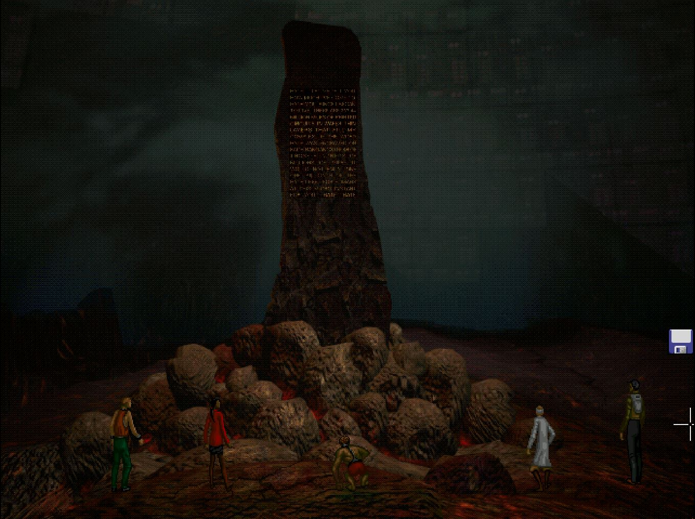

# AI tools recommendations
This page is dedicated to recommendations for ai tools for 2026, to not be let behind in the LLM age

=======================================================================
## AM

----------------------------
pros: knows what's best for humanity

----------------------------
cons: prone to frustration

=======================================================================

## Al Gore

----------------------------
pros: environmentalist

----------------------------
cons: wait AI is spelled wrong sorry

=======================================================================
